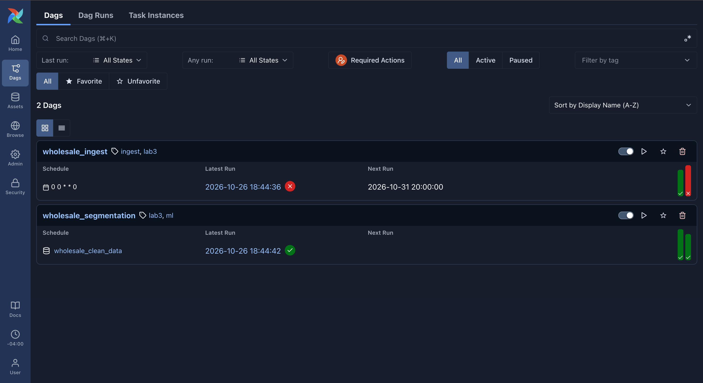
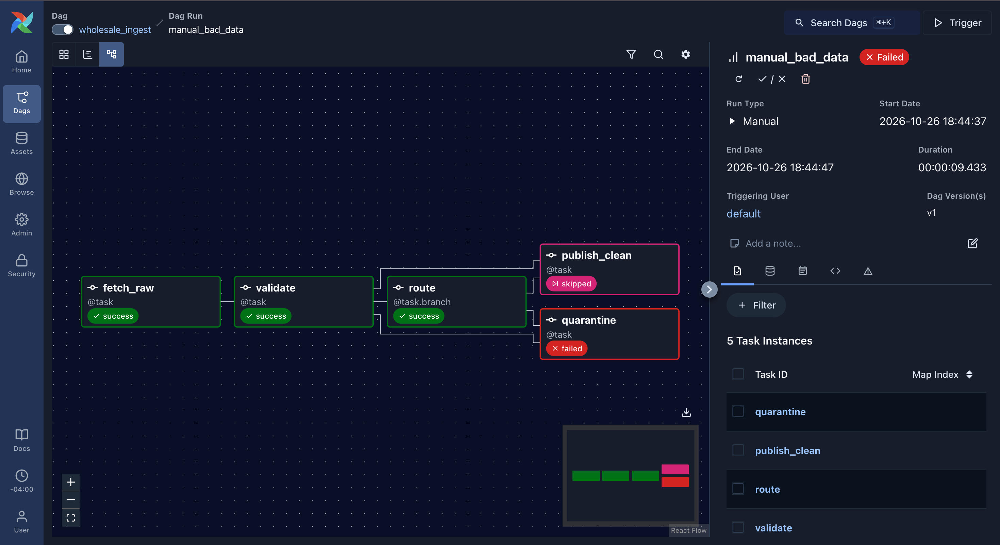
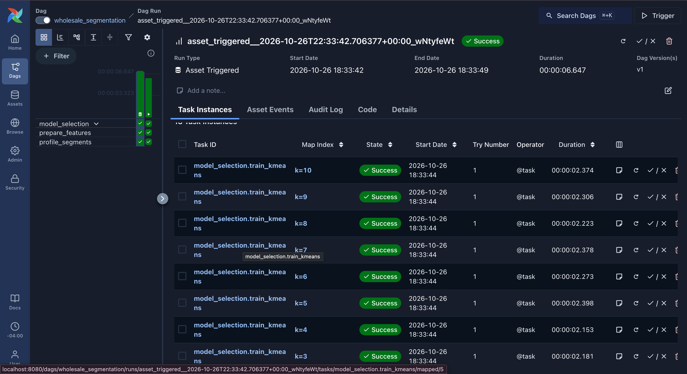
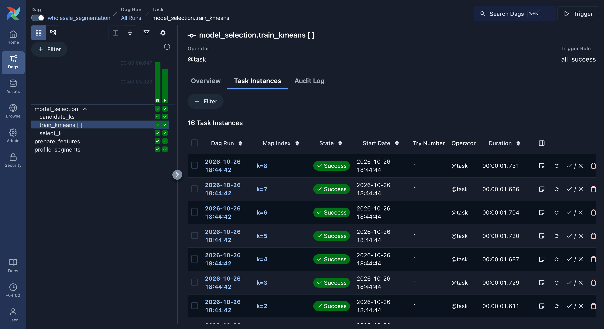
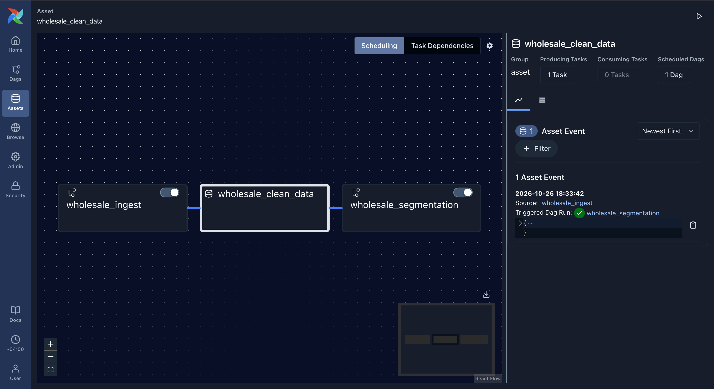

# MLOps Lab 3 – Airflow: Data-Aware Customer Segmentation Pipeline

Lab submission for DADS7305 MLOps (Northeastern University), Airflow topic.
Based on the course lab [Airflow_Labs/Lab_1](https://github.com/raminmohammadi/MLOps/tree/main/Labs/Airflow_Labs/Lab_1).

The original lab is one DAG with four `PythonOperator` tasks in a straight line
(load → preprocess → train K-Means → elbow), passing whole DataFrames between tasks as
base64-encoded pickles in XCom, run by hand. This version rebuilds the **Airflow side**:
two DAGs connected by an **Asset** (data-aware scheduling), the **TaskFlow API**, a **data quality
branch** that quarantines bad data, **dynamic task mapping** that trains one model per `k` in
parallel inside a **task group**, runtime **params**, **retries / timeouts / failure callbacks**,
a custom Docker image, and pytest DAG tests in CI.

The data is the [UCI Wholesale Customers](https://archive.ics.uci.edu/dataset/292/wholesale+customers)
dataset: annual spend of 440 clients of a Portuguese wholesale distributor across six product
categories (Fresh, Milk, Grocery, Frozen, Detergents_Paper, Delicassen), plus their channel
(Horeca = hotel/restaurant/café, or Retail) and region.

## Source

The `original/` folder contains the unmodified lab files from the course repository
(`dags/airflow.py`, `dags/src/lab.py`, data, `setup.sh`, `README.md`).

## My changes

### Airflow changes (the core of the lab)

| | Original lab | This submission |
|---|---|---|
| **DAGs** | One DAG, `Airflow_Lab1` | Two DAGs with separate jobs: `wholesale_ingest` (get + check data) and `wholesale_segmentation` (train + report) |
| **Scheduling** | None (manual trigger only) | `wholesale_ingest` runs `@weekly`. `wholesale_segmentation` is **scheduled on an Asset** (`wholesale_clean_data`): it starts automatically every time ingestion publishes validated data, and never runs on bad data |
| **DAG style** | Classic `PythonOperator(python_callable=..., op_args=[x.output])` | **TaskFlow API** (`@dag`, `@task`, `@task.branch`, `@task_group`) from the Airflow 3 `airflow.sdk` |
| **Passing data between tasks** | Whole DataFrames pickled + base64-encoded into XCom (bloats the metadata DB) | Data written to files in `working_data/`; XCom carries only **paths and small dicts** |
| **Branching** | None | `route` (`@task.branch`) sends the run to `publish_clean` if all 7 quality checks pass, otherwise to `quarantine`, which keeps the bad file + a report and **fails the run on purpose** (`AirflowFailException`) |
| **Parallelism** | `for k in range(1, 50)` loop inside one task | **Dynamic task mapping**: `train_kmeans.partial(prep=...).expand(k=candidate_ks())` creates one task instance per `k`, run in parallel by the Celery worker. A `map_index_template` labels each one `k=2`, `k=3`, … in the UI |
| **Grouping** | – | `candidate_ks → train_kmeans[k] → select_k` wrapped in a **task group** `model_selection` (collapsible in the Graph view) |
| **Runtime inputs** | Hard-coded values | **DAG params** with validation, editable in the UI's *Trigger* form: `k_min`, `k_max`, `features` (subset of categories), `selection_metric` (`silhouette` / `elbow`) for segmentation; `inject_bad_rows`, `use_bundled_copy` for ingestion |
| **Reliability** | `retries: 0`, no timeouts, no alerts | Every task: retries, `execution_timeout`, and an `on_failure_callback` that writes a JSON alert to `working_data/alerts/`. The download task has 3 retries with **exponential backoff**, and on the final try falls back to a bundled copy of the data |
| **Asset metadata** | – | `publish_clean` attaches `{rows, source}` to each asset event (visible under *Assets*) |
| **Outputs** | Model overwritten in place each run | Per-run folder `working_data/segmentation/<run_id>/` – runs never overwrite each other |
| **Docker setup** | `_PIP_ADDITIONAL_REQUIREMENTS` (reinstalls packages on every container start; the compose file warns against it) | **Custom image** (`Dockerfile`, installed against Airflow's official constraints), example DAGs turned off, `working_data/` mounted to the host, `setup.sh` generates a Fernet key |
| **Testing / CI** | None | 17 pytest tests: DAG integrity (no import errors, branch wiring, asset wiring, every task has retries + alert callback) and **full `dag.test()` runs** of both DAGs including the quarantine path. GitHub Actions runs them and also builds the Docker image |

### Data and ML changes

| | Original lab | This submission |
|---|---|---|
| **Dataset** | Credit card customers (`file.csv`), 3 of 18 columns | UCI Wholesale Customers – downloaded at run time, with a bundled copy in `dags/data/` as fallback |
| **Data quality** | `dropna()` only | 7 checks: schema, min rows, no nulls, non-negative spend, valid channel codes, valid region codes, duplicate share |
| **Preprocessing** | MinMax scaling | `log1p` (spend is heavily right-skewed), drop customers that are extreme outliers in 2+ categories, standardise |
| **Choosing k** | Elbow method, but the saved model was the k=49 one | Every k is trained and scored; k chosen by **silhouette** (default) or **elbow**, and the model for the chosen k is used |
| **Results** | Prints one cluster id | Segment profiles (size, average spend per category, % Retail, top category), per-customer segment labels, elbow + silhouette plot, and agreement with the known channel (adjusted Rand index) |

## Project layout

| Path | What it is |
|---|---|
| `dags/wholesale_ingest.py` | DAG 1: download → validate → branch → publish (updates the asset) or quarantine |
| `dags/wholesale_segmentation.py` | DAG 2: asset-scheduled; features → `model_selection` task group (mapped training) → profile |
| `dags/wholesale_lib/` | Plain-Python logic used by the DAGs: `quality.py` (checks), `clustering.py` (features, K-Means, selection, profiling), `alerts.py` (failure callback), `assets.py`, `config.py` |
| `dags/data/wholesale_customers.csv` | Bundled copy of the dataset (fallback if the download fails) |
| `Dockerfile`, `requirements.txt` | Custom Airflow image with the DAGs' packages |
| `docker-compose.yaml` | Official Airflow 3.3.2 compose file; changes are marked `# Lab change` |
| `setup.sh` | Creates the mounted folders and `.env` |
| `tests/`, `pytest.ini`, `requirements-dev.txt` | Tests and local (non-Docker) test environment |
| `.github/workflows/tests.yml` | CI: tests + Docker image build |
| `original/` | Unmodified course lab files |

## 1. What you need to install

| Tool | Version | Notes |
|---|---|---|
| **Docker Desktop** | 4.x (tested with Docker Engine 29.9.2, Compose v5.6.1) | [docker.com/products/docker-desktop](https://www.docker.com/products/docker-desktop/). On first launch choose *Use recommended settings*. Give it **at least 4 GB of memory, 8 GB recommended** (Settings → Resources → Memory) |
| Git | any | To clone the repo |
| Web browser | any | For the Airflow UI |

Everything else (Airflow 3.3.2, Python 3.13, Postgres 16, Redis 7.2, pandas, scikit-learn, kneed,
matplotlib) runs inside containers – nothing else to install. Python is only needed on your
machine if you want to run the tests (see the end).

> **Apple Silicon Macs:** if Docker Desktop shows *"Failed to install Rosetta"*, either install Rosetta
> (`sudo softwareupdate --install-rosetta --agree-to-license`) or untick *Settings → General → Use Rosetta
> for x86_64/amd64 emulation*. All images used here are native arm64, so Rosetta is not required.

Check Docker is running:

```bash
docker --version && docker compose version
docker run --rm hello-world        # prints "Hello from Docker!"
```

## 2. Set up and start Airflow

```bash
git clone https://github.com/Vishwapujara/mlops-lab3-airflow-wholesale-segmentation.git
cd mlops-lab3-airflow-wholesale-segmentation

./setup.sh                          # creates logs/ plugins/ config/ working_data/ and .env
docker compose build                # builds the custom image (first time: a few minutes)
docker compose up airflow-init      # creates the database and the admin user; ends with "exited with code 0"
docker compose up -d                # starts Airflow in the background
```

> On Windows, run the commands in **Git Bash** or WSL so `./setup.sh` works.

Wait about a minute, then check every service is healthy:

```bash
docker compose ps
# airflow-apiserver, airflow-scheduler, airflow-dag-processor, airflow-triggerer,
# airflow-worker, postgres, redis  ->  all "Up ... (healthy)"
```

Open **http://localhost:8080** and log in with **airflow / airflow**.
Under **Dags** you should see `wholesale_ingest` and `wholesale_segmentation` (both paused, no import errors).

## 3. Run the pipeline

### 3a. Normal run: ingestion triggers segmentation automatically

1. Turn on (unpause) **`wholesale_segmentation`** first, using the toggle next to its name, so it can react to new data.
2. Turn on **`wholesale_ingest`**. Because it is `@weekly` with `catchup=False`, Airflow immediately runs it once for the latest week.

Within about a minute:

- `wholesale_ingest` → **success**: `fetch_raw → validate → route → publish_clean` (green), `quarantine` **skipped** (pink).
  The `validate` log shows all 7 checks:
  ```
  [PASS] schema: all 8 columns present
  [PASS] min_rows: 440 rows (need >= 100)
  [PASS] no_nulls: 0 missing values
  [PASS] non_negative_spend: 0 negative spend values
  [PASS] valid_channel: 0 rows outside [1, 2]
  [PASS] valid_region: 0 rows outside [1, 2, 3]
  [PASS] few_duplicates: 0.0% duplicate rows
  ```
- `wholesale_segmentation` starts **by itself** with a run ID beginning `asset_triggered__` → **success**.
  In its Graph view, the `model_selection` group contains `train_kmeans` with **9 mapped tasks, labelled `k=2 … k=10`**.
  The `profile_segments` log ends with:
  ```
   segment  customers   Fresh    Milk  Grocery  Frozen  Detergents_Paper  Delicassen  retail_share top_category
         0        183  9584.0 10390.0  14745.0  2263.0            6082.0      2226.0          0.73      Grocery
         1        252 13909.0  2446.0   2949.0  3701.0             500.0      1037.0          0.03        Fresh
  {'chosen_k': 2, 'selection_metric': 'silhouette', 'silhouette': 0.2955, 'silhouette_k': 2, 'elbow_k': 5,
   'channel_agreement_ari': 0.5354, 'customers': 435, 'outliers_removed': 5, ...}
  ```

  Silhouette picks **2 segments**: grocery/detergent-heavy buyers (73% Retail) and fresh-food-heavy buyers (97% Horeca).
  The clustering never saw the channel column, yet it largely rediscovers it (adjusted Rand index 0.54).

The same results are written to your machine:

```
working_data/
├── raw/scheduled__....csv                      # what was downloaded
├── clean/wholesale_customers.csv               # validated data (the Asset)
└── segmentation/asset_triggered__.../
    ├── summary.json                            # chosen k, scores, settings
    ├── segment_profiles.csv                    # one row per segment
    ├── customer_segments.csv                   # every customer with its segment
    ├── model_selection.png                     # elbow + silhouette curves
    └── models/kmeans_k2.pkl ... kmeans_k10.pkl
```

Under **Assets → wholesale_clean_data** you can see the asset event from `wholesale_ingest`
(with `rows: 440`, `source: UCI download`) and the segmentation run it triggered.

### 3b. Bad data: the quality branch quarantines it

On `wholesale_ingest`, click **Trigger** → in the form tick **`inject_bad_rows`** → **Trigger**.
This corrupts 5 rows (3 negative `Milk` values, 2 missing `Grocery` values).

- The run **fails**, as intended: `fetch_raw`, `validate`, `route` succeed, `publish_clean` is **skipped**, `quarantine` **fails** with:
  ```
  AirflowFailException: Data quality failed (no_nulls, non_negative_spend). File kept at
  /opt/airflow/working_data/quarantine/bad_<run_id>.csv; the clean dataset was NOT updated, so segmentation does not run.
  ```
- `wholesale_segmentation` does **not** start (no new asset event).
- New files: `working_data/quarantine/bad_<run_id>.csv` + `.report.json`, and the failure callback's alert
  `working_data/alerts/wholesale_ingest__quarantine__<time>.json`.

### 3c. Change the model settings with params

On `wholesale_segmentation`, click **Trigger**, change the form, e.g. `selection_metric = elbow`, `k_max = 8` → **Trigger**.

- `train_kmeans` now has 7 mapped tasks (`k=2 … k=8`).
- The elbow method chooses **k = 4**: each channel splits into a smaller and a bigger spender group
  (`segment_profiles.csv` has 4 rows). Invalid input (e.g. `k_min` ≥ `k_max`) fails fast in `candidate_ks`.

### Command-line alternative

The same steps without the UI:

```bash
docker compose exec airflow-scheduler airflow dags unpause -y wholesale_segmentation
docker compose exec airflow-scheduler airflow dags unpause -y wholesale_ingest
docker compose exec airflow-scheduler airflow dags trigger wholesale_ingest -c '{"inject_bad_rows": true}'
docker compose exec airflow-scheduler airflow dags trigger wholesale_segmentation -c '{"selection_metric": "elbow", "k_max": 8}'
docker compose exec airflow-scheduler airflow dags list-runs wholesale_segmentation
```

### Screenshots

**Both DAGs** – ingestion on a weekly cron, segmentation scheduled on the `wholesale_clean_data` asset (the red bar is the bad-data run from 3b):



**Data quality branch (3b)** – checks failed, so `route` skipped `publish_clean` and sent the run to `quarantine`, which failed it on purpose:



**Asset-triggered segmentation run (3a)** – started by the asset event, with one mapped `train_kmeans` task per k, labelled `k=2 … k=10`:



**`model_selection` task group and mapped tasks** – `candidate_ks → train_kmeans [ ] → select_k`; here the elbow run from 3c with `k_max = 8`:



**Asset lineage** – `wholesale_ingest` produces `wholesale_clean_data`, which schedules `wholesale_segmentation`; the event shows the run it triggered:



## 4. Stop and clean up

```bash
docker compose down                 # stop (keeps the database and run history)
docker compose down -v              # stop and delete the database too
rm -rf working_data logs            # delete pipeline outputs and task logs
```

## Running the tests (optional, no Docker needed)

Needs Python 3.13:

```bash
python3 -m venv .venv && source .venv/bin/activate
pip install -r requirements-dev.txt \
  --constraint https://raw.githubusercontent.com/apache/airflow/constraints-3.3.2/constraints-3.13.txt
pytest -v
# 17 passed
```

The tests use a temporary SQLite Airflow database and temporary output folder. `tests/test_dags.py`
checks the DAG structure and runs both DAGs end to end with `dag.test()`, including the quarantine path.
GitHub Actions runs the same tests on every push and also builds the Docker image.
